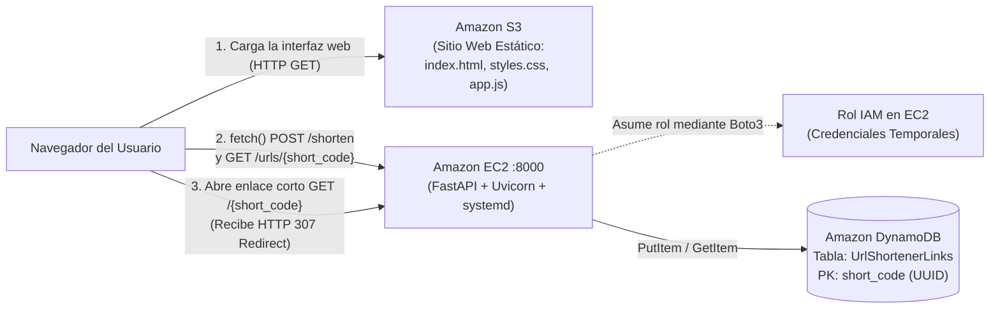

# Guía Paso a Paso: Despliegue en AWS y Pruebas del Midterm

Esta guía cubre todos los pasos de configuración en la consola de AWS, despliegue en **DynamoDB**, **IAM**, **EC2** y **S3**, además del protocolo de pruebas y la estructura recomendada para tu video de entrega.

---

## Arquitectura de la Solución



---

## Paso 1: Subir el Proyecto a tu Repositorio en GitHub o GitLab

El código completo ya fue generado en [aws-url-shortener](file:///C:/Users/emiar/.gemini/antigravity/scratch/aws-url-shortener).

1. Crea un repositorio nuevo (vacío) en GitHub o GitLab (por ejemplo, `aws-url-shortener`).
2. Abre una terminal en la carpeta del proyecto e inicializa Git:
   ```bash
   cd C:\Users\emiar\.gemini\antigravity\scratch\aws-url-shortener
   git init
   git add .
   git commit -m "feat: estructura modular de backend FastAPI y frontend S3 para acortador de enlaces"
   git branch -M main
   git remote add origin https://github.com/<tu-usuario>/<tu-repositorio>.git
   git push -u origin main
   ```

---

## Paso 4: Crear la Tabla en Amazon DynamoDB

1. Entra a la consola de AWS y abre **Amazon DynamoDB** -> **Tables** -> **Create table**.
2. Configura los siguientes valores:
   - **Table name**: `UrlShortenerLinks`
   - **Partition key**: `short_code` (Tipo: **String**)
   - **Sort key**: *(dejar vacío)*
3. En **Table settings**, deja seleccionado **Default settings** (o *On-demand* para evitar costos innecesarios).
4. Haz clic en **Create table**.
5. Una vez activa (`Active`), entra a la pestaña **Overview** -> **Additional info** y copia el **Amazon Resource Name (ARN)** de la tabla (lo usarás en el siguiente paso).

> [!NOTE]
> DynamoDB es *schemaless* para los atributos que no son clave primaria. Los atributos `original_url` y `created_at` se insertan dinámicamente desde [`create_short_link`](file:///C:/Users/emiar/.gemini/antigravity/scratch/aws-url-shortener/backend/app/services.py#L9-L33) cada vez que se ejecuta `table.put_item()`.

---

## Paso 9: Configurar el Rol IAM con Mínimo Privilegio (EC2 -> DynamoDB)

> [!IMPORTANT]
> Nunca guardes `AWS_ACCESS_KEY_ID` ni `AWS_SECRET_ACCESS_KEY` en el código ni en `.env`. Al asociar un rol IAM a la instancia EC2, [`get_dynamodb_table`](file:///C:/Users/emiar/.gemini/antigravity/scratch/aws-url-shortener/backend/app/database.py#L5-L15) obtiene credenciales temporales de forma automática.

### 9.1 Crear la Política IAM (`UrlShortenerDynamoDBPolicy`)
1. Ve a **IAM** -> **Policies** -> **Create policy**.
2. Selecciona la pestaña **JSON** y pega el contenido de [iam-dynamodb-policy.json](file:///C:/Users/emiar/.gemini/antigravity/scratch/aws-url-shortener/deploy/iam-dynamodb-policy.json) reemplazando el `Resource` por el **ARN real** de tu tabla `UrlShortenerLinks`:
   ```json
   {
     "Version": "2012-10-17",
     "Statement": [
       {
         "Sid": "LeastPrivilegeUrlShortenerDynamoDB",
         "Effect": "Allow",
         "Action": [
           "dynamodb:PutItem",
           "dynamodb:GetItem"
         ],
         "Resource": "arn:aws:dynamodb:us-east-1:123456789012:table/UrlShortenerLinks"
       }
     ]
   }
   ```
3. Haz clic en **Next**, nómbrala `UrlShortenerDynamoDBPolicy` y guárdala.

### 9.2 Crear el Rol IAM (`EC2UrlShortenerRole`)
1. Ve a **IAM** -> **Roles** -> **Create role**.
2. En **Trusted entity type**, selecciona **AWS service** y en **Use case** elige **EC2** -> **Next**.
3. Busca y marca la política `UrlShortenerDynamoDBPolicy` que acabas de crear -> **Next**.
4. Nombra el rol `EC2UrlShortenerRole` y haz clic en **Create role**.

---

## Paso 8: Desplegar el Backend en Amazon EC2

### 8.1 Lanzar la instancia EC2
1. Ve a **EC2** -> **Instances** -> **Launch instances**.
2. Configura:
   - **Name**: `url-shortener-backend`
   - **AMI**: **Amazon Linux 2023 AMI** (o Ubuntu Server 24.04 LTS).
   - **Instance type**: `t2.micro` o `t3.micro` (Free Tier).
   - **Key pair**: Crea o selecciona tu par de llaves `.pem`.
3. En **Network settings** -> **Edit** (Security Group):
   - **Regla 1 (SSH)**: Puerto `22`, Source: **My IP** (restringido únicamente a tu IP).
   - **Regla 2 (Custom TCP)**: Puerto `8000`, Source: `0.0.0.0/0` (para permitir peticiones desde el navegador y redirecciones).
4. En **Advanced details** -> **IAM instance profile**, selecciona el rol **`EC2UrlShortenerRole`**.
5. Haz clic en **Launch instance** y copia la **Public IPv4 address** de tu instancia (ejemplo: `54.210.15.88`).

### 8.2 Configurar el entorno en EC2 por SSH
Conéctate a la instancia y ejecuta los siguientes comandos (para **Amazon Linux 2023**):

```bash
ssh -i tu-llave.pem ec2-user@<ip-publica-ec2>

# 1. Instalar Python 3, pip y Git
sudo dnf update -y
sudo dnf install -y git python3 python3-pip

# 2. Clonar tu repositorio
git clone https://github.com/<tu-usuario>/<tu-repositorio>.git aws-url-shortener
cd aws-url-shortener/backend

# 3. Crear entorno virtual e instalar dependencias
python3 -m venv venv
source venv/bin/activate
pip install --upgrade pip
pip install -r requirements.txt

# 4. Crear archivo .env con la IP pública real de tu EC2
cp .env.example .env
nano .env
```

Dentro de `.env`, asegúrate de colocar tu región, el nombre de la tabla y la IP pública de tu EC2:
```ini
AWS_REGION=us-east-1
DYNAMODB_TABLE=UrlShortenerLinks
BASE_URL=http://<ip-publica-ec2>:8000
CORS_ORIGINS=*
PORT=8000
```

### 8.3 Configurar `systemd` para ejecución persistente
Para que el backend siga ejecutándose al cerrar la sesión SSH y se reinicie automáticamente:

```bash
# Copiar el archivo de servicio incluido en el repositorio
sudo cp /home/ec2-user/aws-url-shortener/deploy/url-shortener.service /etc/systemd/system/url-shortener.service

# Recargar systemd, habilitar en el arranque e iniciar el servicio
sudo systemctl daemon-reload
sudo systemctl enable url-shortener
sudo systemctl start url-shortener

# Verificar que esté corriendo ("active (running)")
sudo systemctl status url-shortener
```

> [!TIP]
> Si utilizas **Ubuntu** en lugar de Amazon Linux, cambia `User=ec2-user` y `/home/ec2-user` por `ubuntu` y `/home/ubuntu` dentro de [url-shortener.service](file:///C:/Users/emiar/.gemini/antigravity/scratch/aws-url-shortener/deploy/url-shortener.service).

---

## Paso 7: Desplegar la Interfaz Web en Amazon S3

1. Antes de subir los archivos del frontend, abre [app.js](file:///C:/Users/emiar/.gemini/antigravity/scratch/aws-url-shortener/frontend/app.js#L6) y reemplaza `DEFAULT_API_BASE_URL` con la IP pública de tu EC2:
   ```javascript
   const DEFAULT_API_BASE_URL = "http://<ip-publica-ec2>:8000";
   ```
   *(También puedes editarla directamente desde el cuadro de configuración superior de la interfaz web en el navegador).*
2. Ve a **Amazon S3** -> **Create bucket**:
   - **Bucket name**: un nombre único global, por ejemplo `acortador-web-midterm-2026`.
   - Desmarca **Block *all* public access** y marca la casilla de confirmación.
   - Haz clic en **Create bucket**.
3. Entra al bucket -> pestaña **Objects** -> **Upload** y sube los 3 archivos de la carpeta `frontend/`:
   - [index.html](file:///C:/Users/emiar/.gemini/antigravity/scratch/aws-url-shortener/frontend/index.html)
   - [styles.css](file:///C:/Users/emiar/.gemini/antigravity/scratch/aws-url-shortener/frontend/styles.css)
   - [app.js](file:///C:/Users/emiar/.gemini/antigravity/scratch/aws-url-shortener/frontend/app.js)
4. Ve a la pestaña **Properties**, baja hasta **Static website hosting** -> **Edit**:
   - Selecciona **Enable**.
   - **Index document**: `index.html`.
   - Guarda los cambios y copia el **Bucket website endpoint** (por ejemplo, `http://acortador-web-midterm-2026.s3-website-us-east-1.amazonaws.com`).
5. Ve a la pestaña **Permissions** -> **Bucket policy** -> **Edit** y pega el contenido de [s3-bucket-policy.json](file:///C:/Users/emiar/.gemini/antigravity/scratch/aws-url-shortener/deploy/s3-bucket-policy.json) reemplazando `<nombre-de-tu-bucket>` por el nombre real de tu bucket.
6. *(Opcional pero recomendado para máxima seguridad en CORS)*: actualiza `CORS_ORIGINS` en el archivo `/home/ec2-user/aws-url-shortener/backend/.env` de tu EC2 con la URL del endpoint de S3 y ejecuta `sudo systemctl restart url-shortener`.

---

## Paso 10 y 11: Checklist de Pruebas y Guion para el Video de Entrega

Durante tu grabación, sigue este orden para demostrar todos los criterios de evaluación:

| # | Prueba a demostrar | Qué mostrar en pantalla |
| :--- | :--- | :--- |
| **1** | **Configuración en AWS** | Mostrar en consola de AWS: el bucket S3 con *Static website hosting*, la tabla `UrlShortenerLinks` en DynamoDB, la instancia EC2 corriendo con el Rol IAM `EC2UrlShortenerRole` asignado, y que el código en [`database.py`](file:///C:/Users/emiar/.gemini/antigravity/scratch/aws-url-shortener/backend/app/database.py) no tiene claves hardcodeadas. |
| **2** | **Interfaz en S3 y Validación** | Abrir el enlace público de S3. Intentar enviar un texto inválido (ej. `hola-mundo`) para mostrar el mensaje de error en la interfaz. |
| **3** | **Acortar URL (`POST /shorten`)** | Ingresar una URL válida (ej. `https://aws.amazon.com/es/dynamodb/`) y hacer clic en **Acortar URL**. Mostrar el UUID generado por el backend y el enlace corto resultante. |
| **4** | **Persistencia en DynamoDB** | Ir a DynamoDB -> **Explore table items** en `UrlShortenerLinks` y mostrar el nuevo registro con `short_code`, `original_url` y `created_at`. |
| **5** | **Redirección HTTP (`GET /{short_code}`)** | Usar el botón **Copiar enlace**, pegarlo en una nueva pestaña del navegador y demostrar que el backend en EC2 responde con una redirección HTTP `307 Temporary Redirect` hacia el sitio original. |
| **6** | **Consulta de Metadatos (`GET /urls/{short_code}`)** | En la sección **"2. Consultar información de un enlace"** de la interfaz (o en el navegador), consultar el UUID creado y mostrar el JSON / metadatos recuperados de DynamoDB. |
| **7** | **Manejo de Error `404 Not Found`** | Intentar acceder a `http://<ip-publica-ec2>:8000/00000000-0000-0000-0000-000000000000` (o consultarlo en la sección 2) y comprobar que devuelve `404 Not Found`. |
| **8** | **Persistencia tras reiniciar el backend** | En la terminal SSH ejecutar `sudo systemctl restart url-shortener` (y cerrar la sesión SSH), volver a abrir el enlace corto y demostrar que sigue redirigiendo gracias a `systemd` y DynamoDB. |
